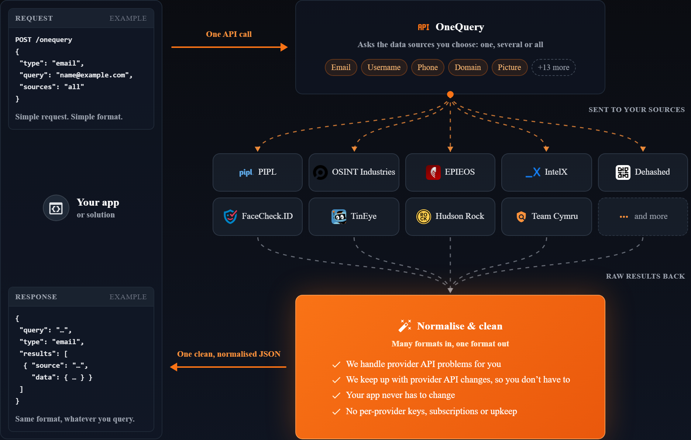

<p align="center">
  <a href="https://usersearch.com/product/onequery/">
    
  </a>
</p>

<h1 align="center">One API key. One call. Multiple premium sources.</h1>

<p align="center">
  The UserSearch SDK for JavaScript and TypeScript.<br>
  Search across your selected data providers and get their findings back together.
</p>

<p align="center">
  <a href="https://usersearch.com/product/onequery/">Explore OneQuery</a> ·
  <a href="https://public-api.usersearch.ai/docs/">API reference</a> ·
  <a href="examples/">Examples</a> ·
  <a href="docs/advanced.md">Advanced usage</a>
</p>

## 100+ sources. One integration.

OneQuery brings together over 100 data sources through one UserSearch integration. Choose the providers available for your search type, pass your query, and get their findings back together.

This email example selects three providers:

```js
import UserSearch from 'usersearch-sdk';

const client = new UserSearch({ apiKey: process.env.USERSEARCH_API_KEY });

const { data } = await client.search({
  type: 'email',
  query: 'person@example.com',
  sources: ['predicta', 'epieos', 'osintindustry'],
});

console.log(data.results);
```

**That is the integration.** One UserSearch key gives your application access to supported providers. Add or remove sources in the same request, and consume a shared result structure with source attribution.

One SDK call handles submission and polling until the result is ready. You do not need to build a separate client for each provider.

## How it works

Your app sends one query. UserSearch asks your selected providers, brings their findings together, and returns a consistent result structure.

<p align="center">
  <a href="https://usersearch.com/product/onequery/">
    
  </a>
</p>

*OneQuery product illustration from [usersearch.com](https://usersearch.com/product/onequery/). For this SDK’s supported search types and providers, see [Choose your sources](#choose-your-sources); use the SDK example above for the actual request syntax.*

Searches use account credits. Provider availability depends on the search type and API configuration. [Estimate the cost](#check-the-cost-first) before submitting if needed.

> **Private preview · v0.2.0-beta.1**
>
> Available to repository collaborators. The package is not yet published to npm.

## Built for your application

- **Multiple sources per search** — select providers explicitly or let the API choose compatible defaults.
- **Cost checks before submission** — validate input and retrieve an estimate without starting a search.
- **Consistent results** — retain source attribution, partial results, and individual provider outcomes.
- **Recoverable submissions** — retries reuse the same result and idempotency keys.
- **JavaScript and TypeScript** — ES modules and CommonJS, with no runtime dependencies.

| Search type | Input |
| --- | --- |
| Username | A username or handle |
| Email | An email address |
| Phone | A number with an international country code, such as `+442079460000` |
| Image | A supported image encoded as a base64 data URI |

**Runtime:** Node.js 22.13+ in the 22 series, or Node.js 24. Tested on Windows and Linux. This is a server-side SDK; browser use is not supported.

## Installation

Install from the private GitHub repository using an account with access:

```sh
npm install git+https://github.com/UserSearch-Public/usersearch-sdk-js.git
```

For reproducible deployments, pin the Git URL to a reviewed commit or install a versioned tarball. See [installation and releases](docs/releases.md).

Before making API calls, activate your UserSearch API key, register your server’s outbound IP, and set `USERSEARCH_API_KEY` in the server environment.

Save the example above as `search.mjs` and run `node search.mjs`.

For CommonJS:

```js
const { UserSearch } = require('usersearch-sdk');
```

**Try it without an API key:** clone this repository, run `npm ci`, then `npm run demo`. The [simulated demo](examples/demo.mjs) shows multiple sources, a partial failure, encrypted saving, and recovery without network calls or charges.

## Choose your sources

Use a single provider or several with the same method. For example, the email search above queries Predicta, Epieos, and OSINT Industries together. Omit `sources` to use the API’s defaults for your search type; an empty list is rejected.

The current SDK supports **username, email, phone, and image** searches. See the [API reference](https://public-api.usersearch.ai/docs/) for supported provider combinations and current availability.

## Check the cost first

Cost estimation is optional and does not start a search. Using the same `client`:

```js
const input = {
  type: 'email',
  query: 'person@example.com',
  sources: ['predicta', 'epieos', 'osintindustry'],
};

const { data: quote } = await client.cost(input);
console.log('Estimated cost:', quote.cost, 'cents');
```

Each `search()` call starts a new paid search; charges are final, including when a source fails. The cost estimate is advisory and is not a spending cap.

## Working with results

Network methods return `{ data, meta }`:

| Field | Contents |
| --- | --- |
| `data.results` | Findings returned by a search |
| `data.sources` | Each source’s status, including failures |
| `meta.requestId` | Request identifier for support and diagnostics |
| `meta.status` | HTTP response status |
| `meta.retryAfterMs` | Suggested retry delay in milliseconds, or `null` |

One source failing does not discard another source’s findings. Inspect `data.sources` as well as the overall search status. Search results are returned normally even when every source fails.

> **Results are delivered once.**
>
> Save the terminal response when you receive it. The SDK caches it on the search handle; optional [encrypted storage and job recovery](docs/advanced.md#encrypted-storage) preserve results across application restarts.

## Client methods

| Method | Purpose |
| --- | --- |
| `health()` | Read API and source health |
| `balance()` | Read the account balance in cents |
| `cost(input)` | Validate and estimate a search without submitting it |
| `search(input, options)` | Submit a new search and wait for its result |
| `prepare(input)` → `submit(prepared)` | Control submission and preserve retry credentials |
| `results(handle)` / `wait(handle)` | Collect once or poll until the search finishes |
| `runJob(jobId, input, options)` | Start or resume a job using configured persistent storage |

Omit `sources` to use API defaults. An empty source list is rejected. Provider availability and accepted image constraints are determined by the API.

## Errors and configuration

```js
import UserSearch, { UserSearchError } from 'usersearch-sdk';

const client = new UserSearch({
  apiKey: process.env.USERSEARCH_API_KEY,
  timeoutMs: 30_000,
  maxRetries: 2,
});

try {
  await client.balance({ requestTimeoutMs: 10_000, maxRetries: 0 });
} catch (error) {
  if (!(error instanceof UserSearchError)) throw error;
  console.error(error.toJSON());
}
```

Errors expose a machine-readable code, request ID, charge state, and an actionable hint. Specific classes distinguish authentication, permissions, invalid input, rate limits, API failures, connection errors, and uncertain result delivery.

Retries preserve submission identity and honor `Retry-After`. An ambiguous result-collection failure is never retried automatically because the API may already have delivered and deleted the response.

See [timeouts, progress, and cancellation](docs/advanced.md#timeouts-progress-and-cancellation) for request overrides and polling controls.

## Documentation and support

- [API reference](https://public-api.usersearch.ai/docs/) — endpoints, schemas, sources, and pricing behavior.
- [Advanced usage](docs/advanced.md) — images, recovery, encrypted storage, and operational limits.
- [Examples](examples/) — a balance check and a fully simulated search workflow.
- [Changelog](docs/CHANGELOG.md) — SDK changes and migration notes.
- [Releases and compatibility](docs/releases.md) — installation, versioning, and supported runtimes.
- [Contributing](.github/CONTRIBUTING.md) — development commands and test requirements.

For SDK issues, [open an issue](https://github.com/UserSearch-Public/usersearch-sdk-js/issues/new) with the SDK version, Node.js version, error code, and request ID. Do not attach credentials, result keys, or personal search data.

## Development

```sh
npm ci
npm run verify
npm run demo
```

Verification covers runtime tests, TypeScript consumers, and installed-package imports. GitHub Actions checks Windows and Linux on Node.js 22.13 and 24. The optional `npm run check:contract` command checks the public API specification for changes.

## License

Proprietary — `UNLICENSED`. This private preview does not grant an open-source license.
